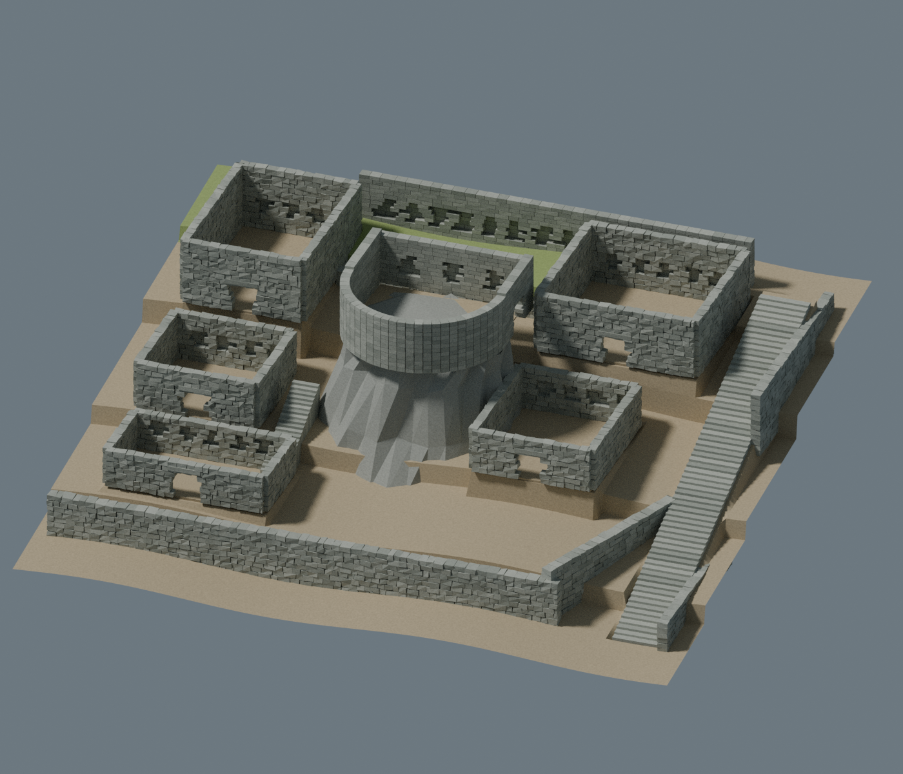

# Machu Picchu — reconstrucción en curso para Unity 6.6

**El encargo completo sigue pendiente.** La versión actual corrige las formas y los
desniveles del sector del torreón como estudio visual de la imagen proporcionada.
No es una réplica exacta, no cubre toda la ciudadela y no está validada en Play mode.



## Qué cambió

- Basamento rocoso inclinado bajo el torreón, muro curvo y recintos superiores.
- Plataformas escalonadas, edificios a distintas cotas, muros de contención,
  nichos y escaleras con peldaños geométricos.
- El suelo del estudio tiene unos 11,8 m de desnivel y la escalera lateral recorre
  casi 12 m de altura. Estas cifras describen el **modelo estimado**, no una medición
  de Machu Picchu. Las formas y materiales siguen simplificados.
- Se encontró el plano del recorrido y se registraron 25 posiciones de panorámicas.
  Sus coordenadas son píxeles y no proporcionan escala métrica ni altitudes.

El sector usa un área local estimada de **50 × 44 m**. No sustituye ni cambia el
alcance general de **530 × 200 m** solicitado para la ciudadela. El antiguo
prototipo general se conserva por separado y su distribución en cuadrícula no se
considera una reconstrucción válida del lugar.

## Abrir y editar

1. Descargar este repositorio mediante **Code > Download ZIP** y extraerlo.
2. Abrirlo con Unity **6.6**. Se ha fijado la versión oficial **6000.6.7f1**.
   Usar **Built-in Render Pipeline** y **Active Input Handling: Input System Package (New)**.
   El proyecto incluye Input System 1.20.1, verificado en el paquete oficial de Unity
   6000.6.7f1. Aceptar el reinicio del editor cuando se solicite.
3. Para generar una escena editable y verla fuera de Play, ejecutar
   **Machu Picchu > Crear escena del sector de referencia**. Se guarda una carpeta
   nueva en `Assets/MachuPicchu/Generated/ReferenceSector_...` sin sobrescribir
   escenas anteriores. El suelo del sector es una malla editable en Blender.
4. Como alternativa, abrir `Assets/MachuPicchu/Scenes/ReferenceSector.unity` y pulsar
   Play: esa escena de arranque construye su contenido al ejecutarse. Sus cambios
   hechos en Play no se conservan. La ejecución todavía requiere validación.

Controles: clic para capturar el ratón, WASD/flechas para caminar, ratón para mirar,
Escape para liberar el cursor. La escena incorpora MeshColliders y controlador,
pero su presencia no prueba que todos los recorridos funcionen.

## Fuentes y archivos

- [Blender editable del sector](Artifacts/ReferenceSector_VisualEstimate.blend).
- [FBX del sector](Assets/Resources/MachuPicchu/ReferenceSector_VisualEstimate.fbx).
- [Informe de geometría exportada](Artifacts/reference-sector-fbx-check.json).
- [Procedencia y límites de la reconstrucción](Documentation/REFERENCE_SECTOR.md).
- [25 posiciones del plano del recorrido](Documentation/tour-map-positions.json).
- [Fuente de la figura del PDF](Documentation/VISUAL_REFERENCE_01.md).

La figura 10 del artículo acredita el modelo original del torreón a Luis Jaime
Castillo/PASJM, construido con 2829 fotos. **Ese modelo original no se ha obtenido.**
Las panorámicas ya son accesibles y se inspeccionaron imágenes de referencia. No
se redistribuyen sus fotografías como materiales del proyecto.

## Validación

- Blender generó, renderizó y reimportó el FBX: 40 mallas y desniveles presentes.
- Pasaron las 14 pruebas Python del conversor y del antiguo prototipo general.
  No certifican la fidelidad ni la jugabilidad del sector nuevo.
- Se instaló Unity 6000.6.7f1 y se verificó la integridad de su archivo oficial.
- Runtime y Editor C# compilan contra sus bibliotecas oficiales. Se corrigió una
  incompatibilidad de GetInstanceID con Unity 6.6.
- **El arranque del editor está bloqueado por falta de licencia activada**, código
  198. No se ha validado la importación del proyecto, Play mode, la física ni el build.

Detalles: [comprobación de Unity](Documentation/UNITY_VALIDATION.md).
El agente trabaja en la nube; no controla el PC del usuario.

## Reproducir

Blender 4.3.2 para la geometría; Python 3 y NumPy 2.3.5 para el prototipo general.

```bash
blender -b --threads 4 --python-exit-code 1 --python Tools/build_reference_sector.py
python3 -m unittest discover -s Tests -v
python3 Tools/check_unity_csharp.py
```

El último comando requiere la instalación de Unity en la nube. `Tools/install_unity_cloud.py`
instala la versión fijada en `/workspace/toolchains` con verificación del archivo;
`Tools/unity_cloud.sh` configura directorios XDG escribibles. La activación es un
paso independiente. Los generadores sobrescriben sus propias salidas: guardar una
copia de cualquier `.blend` editado antes de ejecutarlos.

Para importar topografía real posteriormente se conserva `Tools/prepare_dem.py`
y el menú **Machu Picchu > Importar terreno medido**. La distribución y altitudes
de toda la ciudadela necesitan datos métricos antes de poder afirmar fidelidad.
