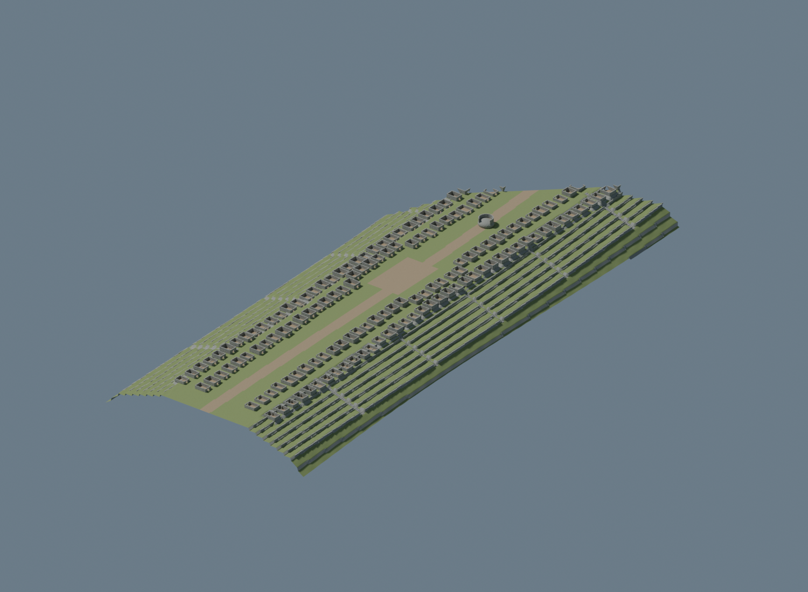

# Machu Picchu — prototipo interpretable para Unity 6.6

**Se entrega un modelo aproximado, no una reconstrucción arqueológica exacta ni
ultrarrealista.** El terreno y la distribución se generaron a partir de medidas
generales proporcionadas por el usuario, no de un levantamiento. La imagen del
artículo se utilizó como referencia de un muro curvo sobre roca; su malla no está
incluida. En la revisión posterior, la página principal respondió HTTP 200 y se pudo
inspeccionar una imagen del templo. Los servidores de panorámicas siguen bloqueados
por HTTP 403 del proxy. Ver `Documentation/REVIEW.md`.

El render se puede ver sin conexión abriendo **Artifacts/REVIEW.html**.



## Corrección visual del sector del torreón

Se añadió un estudio independiente de la figura 10 del PDF: roca elevada, muro
curvo, plataformas a distintas cotas, recintos escalonados y escalera lateral.
**Las dimensiones de este sector son estimaciones visuales; no es una réplica
exacta ni una reconstrucción completa de la ciudadela.** Su área de trabajo local
es 50 × 44 m; no modifica ni reemplaza el límite general de 200 × 530 m.


- Fuente editable: `Artifacts/ReferenceSector_VisualEstimate.blend`.
- FBX: `Assets/Resources/MachuPicchu/ReferenceSector_VisualEstimate.fbx`.
- En Unity: **Machu Picchu > Crear escena del sector de referencia**. Genera una
  escena separada con MeshColliders y controlador; requiere comprobar la compilación
  y la física en Unity 6.6. El suelo de este sector es una malla editable en Blender,
  no un TerrainData nativo.
- Generación: `blender -b --threads 4 --python-exit-code 1 --python Tools/build_reference_sector.py`.

En esta revisión sí se pudieron consultar los servidores de panorámicas. No se
redistribuyen sus fotografías como texturas. Se localizaron los datos oficiales
de Unity 6000.6.7f1; descargar el editor desde download.unity3d.com sigue bloqueado
por el proxy. El dominio quedó añadido al borrador de configuración.

## Prototipo general anterior — no aceptado como reconstrucción

- Superficie de **200 m de ancho × 530 m de largo**, con relieve y terrazas.
- Heightmap de **513 × 513** muestras para TerrainData nativo, pintable y esculpible.
- **172 recintos interpretativos**, cada uno como objeto independiente, con pisos,
  muros de mampostería y aberturas; no son plantas documentadas del sitio.
- Muros de contención, diez tramos de escaleras y una interpretación del muro curvo
  sobre roca. Sus dimensiones y ubicaciones son aproximaciones inventadas.
- Escena de arranque que genera el conjunto al iniciar Play, y herramienta para
  guardar Terrain, Architecture y Exploration como escenas editables separadas.
- Controlador peatonal, MeshCollider para arquitectura, TerrainCollider, límites
  de recorrido y recuperación de posición mediante R.
- Fuente de Blender, exportación FBX y vista renderizada del modelo generado.

La cota media de la superficie se ajustó a **2430 m** como referencia proporcionada
por el usuario. La amplitud del relieve es inventada, no una medición. Las posiciones
locales evitan números grandes: la cota absoluta es Y local + 2390 m. El eje largo es
Z; no se conoce su orientación geográfica. El Santuario Histórico y las montañas
exteriores no están modelados. Las tres alturas de cumbres recibidas se conservan
como metadatos, sin inventar sus posiciones.

## Ejecutar en Unity 6.6

1. Extraer el proyecto completo y abrirlo con Unity **6.6**, usando el renderizador
   **Built-in**. Añadir la carpeta desde Unity Hub; si Hub no identifica la versión,
   seleccionar tu editor 6.6 o abrirlo con `Unity -projectPath "ruta/al/proyecto"`.
   El parche exacto del editor no fue proporcionado, por lo que no se ha inventado
   un ProjectVersion.txt; Unity lo escribirá al abrir el proyecto.
2. Esperar la importación del FBX y la compilación. En **Project Settings > Player >
   Other Settings**, usar **Active Input Handling: Input Manager (Old)** o **Both**.
3. Abrir **Assets/MachuPicchu/Scenes/Prototype.unity** y pulsar **Play**. La escena
   de arranque construye el mundo al iniciar; en modo edición inicialmente solo
   muestra el objeto generador. Las modificaciones realizadas durante Play no se guardan.
4. Clic para capturar el ratón; **WASD/flechas** para caminar, **ratón** para mirar,
   **Escape** para liberar el cursor y **R** para volver al inicio.

### Guardar y editar el mundo

Fuera de Play, ejecutar **Machu Picchu > Crear escenas editables del prototipo**.
Se genera una carpeta única en `Assets/MachuPicchu/Generated/Prototype_...` con:

- `Terrain.unity` y `Terrain.asset`: terreno y capas editables con las herramientas
  de Terrain de Unity. Mantener tamaño (200, 100, 530) y escala (1, 1, 1).
- `Architecture.unity`: recintos y demás mallas, con colliders. Las posiciones de
  los objetos son editables; para alterar sus vértices utilizar la fuente de Blender.
- `Exploration.unity`: jugador, iluminación y carga aditiva de las otras escenas.

La herramienta abre Exploration y coloca estas escenas al principio de Build
Settings. Para editar edificios o relieve, abrir su escena o añadirla de forma
aditiva. Las nuevas ejecuciones crean carpetas distintas para preservar cambios.
Respaldar las escenas generadas: esa carpeta está excluida de Git por su tamaño.

## Archivos principales

- `Artifacts/MachuPicchu_Interpretive.blend`: escena editable, unidades métricas.
- `Artifacts/Overview_INTERPRETIVE.png`: render real del archivo de Blender.
- `Assets/Resources/MachuPicchu/Architecture_Interpretive.fbx`: arquitectura.
- `Assets/Resources/MachuPicchu/prototype-layout.json`: dimensiones, posiciones,
  procedencia y límites de precisión.
- `Assets/Resources/MachuPicchu/prototype-heightmap.bytes`: alturas de 16 bits.
- `Tools/build_prototype.py`: generación determinista del relieve y distribución.
- `Tools/build_blender_scene.py`: generación de arquitectura, FBX y archivo Blender.

El render usa materiales procedurales de Blender. Unity usa materiales Standard
procedurales propios; su apariencia no es idéntica al render. No hay texturas
fotográficas, HDRP, vegetación detallada, montañas de fondo, LOD de producción ni
iluminación horneada. Es una base de trabajo de fidelidad limitada.

## Validación realizada y pendiente

Pasaron **14 pruebas Python**: conversión de datos medidos, dimensiones del prototipo,
integridad del heightmap, media de elevación, recuento de recintos, ausencia de
solapamientos entre plantas y ubicación inicial. Blender generó y renderizó la
geometría. La exportación FBX se reimportó en Blender para comprobar que los 172
recintos mantienen sus posiciones. Informes en `Artifacts/*validation.json`.

**Unity Editor no está instalado/activado aquí.** No se ha compilado el C#, abierto
la escena en Unity, probado la física ni construido un ejecutable. Antes de llamar
al proyecto jugable y validado, verificar en Unity 6.6 la importación y orientación
del FBX, los materiales, el movimiento, los escalones, los vanos y la carga de
escenas. Perfilar geometría/colliders en el PC objetivo antes de aumentar detalle.
No se afirma una tasa de FPS. El acceso del agente sigue limitado a la nube.

Para datos medidos posteriores, permanece disponible `Tools/prepare_dem.py` y el
menú **Machu Picchu > Importar terreno medido**. Ese flujo exige un DEM real con
unidades, CRS y datum conocidos; no tratar el prototipo como una medición.

## Regeneración

Python 3 con NumPy 2.3.5 (`python3 -m pip install -r Tools/requirements.txt`) y Blender 4.3.2. Ejecutar desde la raíz del proyecto:

```bash
python3 Tools/build_prototype.py
blender -b --threads 4 --python-exit-code 1 --python Tools/build_blender_scene.py
python3 -m unittest discover -s Tests -v
```

Los generadores sobrescriben solamente sus salidas deterministas del prototipo,
FBX y Artifacts; copiar primero el `.blend` si se ha editado manualmente. La herramienta
Unity guarda cada importación en una carpeta nueva. Ver `Documentation/` para la
procedencia del artículo y las tareas de reconstrucción pendientes.
